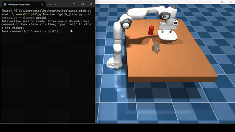
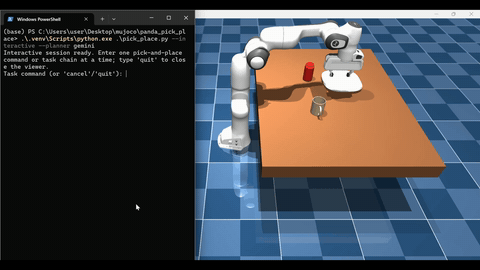
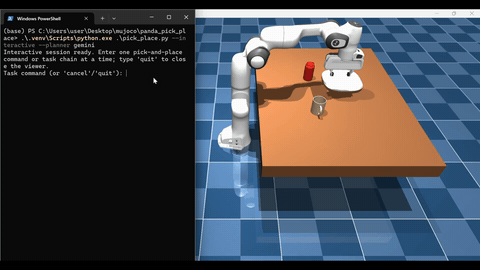
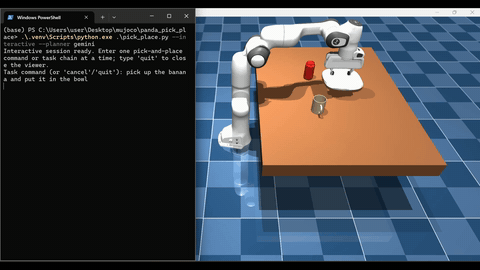

# Panda Language Pick and Place

A human-language command interface for tabletop manipulation with a Franka Panda in MuJoCo. Give the system a request such as “move the soda can onto the plate,” and it resolves the request into a supported task, plans a fixed sequence of manipulation skills, and executes the sequence in simulation.

This repository is a state-based robotics demonstration: object poses are read directly from MuJoCo. It does not use a simulated camera, visual perception, a learned manipulation policy, or an end-to-end vision-language-action model.

## Demonstrations

### Single-task pick and place

A single supported object is picked up and placed on the requested surface.



### Ordered multi-task execution

A command can request several pick-and-place operations. The system executes them in order and refreshes the scene state between tasks.


### Flexible phrasing

Gemini maps paraphrased natural-language commands to the project's registered object and surface names, so commands do not need one exact sentence template.



### Hindi command

The Gemini planner can interpret a Hindi command and map it to the same supported pick-and-place actions.



### Error handling

Unsupported requests and invalid task interpretations are rejected before execution; runtime checks stop a sequence when grasping, lifting, or placement does not meet the configured checks.



## What the system does

- Simulates a Franka Panda arm and parallel gripper in MuJoCo.
- Loads a fixed tabletop scene containing a handled coffee mug, soda can, and plate, with placement locations on the table.
- Accepts single or ordered multi-task pick-and-place commands.
- Uses either a local rules-based parser or Gemini for command interpretation.
- Reads current object and surface positions directly from MuJoCo's simulation state in meters.
- Converts each accepted task into the same validated sequence: approach, grasp, lift, transfer above the destination, lower, release, and retreat.
- Checks gripper contact, lift height and drift, placement position, and whether the requested placement is already satisfied.
- Stops and reports a failure when task validation or execution checks fail.

The Gemini service receives the text command and allowed canonical entity labels. It does not receive images, object coordinates, or the MuJoCo simulation state. Gemini proposes task entities and relations; local validation determines whether the request is supported, and local robot skills determine the motions.

## How it works

1. **Scene initialization:** `scene.xml` combines the local Panda model in `robot.xml` with the table, objects, and placement sites. Free-joint objects can move during simulation.
2. **Command interpretation:** `pick_place.py` receives a command. The `rules` planner parses known phrasing locally. The optional `gemini` planner maps paraphrases and multilingual phrasing to registered entities.
3. **Validation and task planning:** `task_planner.py` validates object names, destination names, placement relations, and task order. Unsupported tasks are rejected before the robot acts.
4. **Live state and target calculation:** the executor reads current object body positions and surface-site positions from MuJoCo. It chooses an available tabletop placement location based on current obstacle positions.
5. **Skill execution:** `robot_skills.py` executes the fixed pick-and-place primitives using inverse kinematics and interpolated joint commands.
6. **Runtime verification:** contact, lift, placement, and retreat checks provide a success/failure result. A failed subtask stops the remaining sequence.

## Requirements

- Windows PowerShell commands below assume the project folder is the current directory.
- Python 3.13 (used for the project setup).
- MuJoCo and other Python packages listed in `requirements.txt`.
- A Gemini API key only when using `--planner gemini`.

## Installation

Open PowerShell in the repository folder and create a virtual environment:

```powershell
py -3.13 -m venv .venv
.\.venv\Scripts\python.exe -m pip install --upgrade pip
.\.venv\Scripts\python.exe -m pip install -r requirements.txt
```

The project contains the converted OBJ files needed by the MuJoCo scene under `assets/converted/`. The original SimReady source packages and attribution are retained under `assets/simready_source/`.

## Run the scene

Print the initial object coordinates:

```powershell
.\.venv\Scripts\python.exe .\inspect_scene.py
```

Open the scene viewer while inspecting the coordinates:

```powershell
.\.venv\Scripts\python.exe .\inspect_scene.py --viewer
```

## Run tasks with the rules planner

The rules planner is the default and does not require an API key:

```powershell
.\.venv\Scripts\python.exe .\pick_place.py "pick up the coffee mug and place it on the plate"
.\.venv\Scripts\python.exe .\pick_place.py "move the soda can onto the table"
```

A command can contain multiple ordered tasks:

```powershell
.\.venv\Scripts\python.exe .\pick_place.py "move the coffee mug onto the plate, then put the soda can on the table"
```

The built-in parser recognizes registered names and common aliases for the mug, can, plate, and table. It accepts a limited set of connectors for chaining tasks. The Gemini planner supports more flexible phrasing.

## Use Gemini for command interpretation

Create a `.env` file from the example, then add your key from [Google AI Studio](https://aistudio.google.com/app/apikey):

```powershell
Copy-Item .env.example .env
notepad .env
```

Replace the placeholder value for `GEMINI_API_KEY` in `.env`. The `.env` file is excluded from Git; never commit or share your personal API key.

Run a Gemini-planned task:

```powershell
.\.venv\Scripts\python.exe .\pick_place.py --planner gemini "move the soda can onto the plate"
.\.venv\Scripts\python.exe .\pick_place.py --planner gemini "put the mug on the plate, then place the can on the table"
```

The default model is `gemini-3.1-flash-lite`. Set `GEMINI_MODEL` in `.env` to override it if needed. Gemini calls depend on network availability and the provider's current quotas and service availability.

## Interactive session

Start one MuJoCo session and enter commands repeatedly in the terminal:

```powershell
.\.venv\Scripts\python.exe .\pick_place.py --interactive
```

Use Gemini in interactive mode for paraphrased or multilingual commands:

```powershell
.\.venv\Scripts\python.exe .\pick_place.py --interactive --planner gemini
```

Enter one command at each prompt. Type `quit` or `exit` to close the session. Type `cancel` to discard a pending incomplete Gemini request. The scene persists between commands; the executor reads fresh object positions before each task. If a task fails an execution check, the session stops the sequence and keeps the viewer available for inspection.

## Other utilities

Move the tool center to a world-space XYZ coordinate (meters) while preserving its current orientation:

```powershell
.\.venv\Scripts\python.exe .\move_to_coordinate.py 0.42 -0.16 0.55 --gripper open
```

Run the Gemini command interpretation evaluation cases:

```powershell
.\.venv\Scripts\python.exe .\evaluate_gemini_commands.py
```

This evaluation sends command text to Gemini and does not launch MuJoCo. It requires a configured API key and network access.

## Repository map

| Path | Purpose |
| --- | --- |
| `pick_place.py` | CLI, live-state target calculation, placement-site selection, and task execution orchestration |
| `task_planner.py` | Registered objects and surfaces, rules parsing, and validated action plans |
| `gemini_command_interpreter.py` | Gemini request, structured response parsing, and task validation handoff |
| `robot_skills.py` | Panda pick, carry, placement, gripper, and verification skills |
| `move_to_coordinate.py` | Inverse-kinematics coordinate motion utility |
| `inspect_scene.py` | Scene viewer and object/site coordinate inspection |
| `evaluate_gemini_commands.py` | Small command interpretation evaluation set |
| `scene.xml`, `robot.xml` | MuJoCo tabletop scene and Panda model |
| `assets/converted/` | OBJ meshes referenced by the MuJoCo scene |
| `assets/simready_source/ATTRIBUTION.md` | Source asset attribution and license notes |
| `PANDA_LICENSE` | License for the Panda model assets |

## Current scope and limitations

- The active scene supports the handled coffee mug and soda can, with placement on the plate or selected tabletop locations.
- Object state is available from MuJoCo directly; there is no camera input, perception pipeline, or real-robot connection.
- Gemini interprets task language. Motion is produced by hand-authored skills and inverse kinematics; this is not a trained VLA policy.
- The robot uses direct IK and joint-space interpolation for motion. General collision-aware path planning and automatic recovery are not implemented.
- Unsupported relations such as “beside” or “inside” are rejected. The current placement behavior places objects on top of a supported surface.
- Simulation results depend on the scene geometry, object collision proxies, contacts, and physics settings.

## Assets and licenses

The object meshes originate from SimReady packages and are converted for MuJoCo. Review `assets/simready_source/ATTRIBUTION.md` for asset attribution and license details. The Panda model license is provided in `PANDA_LICENSE`. Retain these notices when redistributing the repository. The demo GIFs are stored in `assets/` and embedded above.

## Project terminology

A precise description is **natural-language-conditioned, state-based robotic manipulation with LLM task planning and scripted skills**. In this implementation, “state-based” means object positions are read directly from MuJoCo rather than estimated from images; “LLM task planning” means Gemini can map language to supported entities and task relations; the physical motions come from deterministic robot skills.
